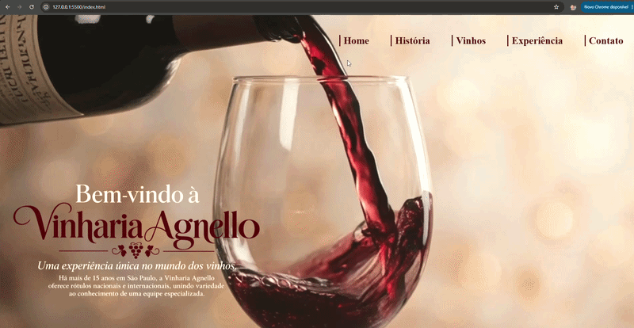

# Vinharia Agnello


## Sobre o projeto

Este projeto foi desenvolvido como um trabalho acadêmico da disciplina de Front-end Design, a partir do desafio de criar um site para a Vinharia Agnello, uma empresa fictícia especializada em vinhos. A proposta foi imaginar a presença digital da marca e desenvolver uma experiência que apresentasse sua história, seus produtos e as diferentes experiências oferecidas aos clientes.

O site foi desenvolvido individualmente, desde a estruturação das páginas até a organização dos conteúdos e elementos visuais. Ao longo do projeto, trabalhei com a criação de diferentes páginas, navegação entre conteúdos, composição dos layouts, utilização de imagens, tipografia, cores e outros recursos de HTML e CSS aprendidos durante a disciplina.

Um dos pontos que ajudou a dar mais personalidade ao projeto foi a utilização de Inteligência Artificial na criação das imagens. A IA foi utilizada para desenvolver ambientes, cenas da vinheria, imagens relacionadas aos vinhos e elementos da identidade visual, tornando os materiais mais personalizados e ajudando a dar uma aparência mais real àquilo que inicialmente existia apenas como uma proposta fictícia.

O resultado é uma experiência digital criada do zero, que busca unir estrutura, conteúdo e identidade visual para dar vida a uma marca que não existe no mundo real. O projeto também foi uma oportunidade de colocar em prática os conhecimentos desenvolvidos durante a disciplina, experimentar novas possibilidades e transformar uma proposta fictícia em um site funcional, visualmente consistente e com uma identidade própria. Diante do resultado alcançado e de todo o processo de desenvolvimento, este projeto também fará parte do meu portfólio como um dos trabalhos que representam minha evolução na área de desenvolvimento web.


## Estrutura do projeto

```
Vinharia-Agnello-CheckPoint-Front/
│
├── src/
│   ├── assets/
│   │   └── imgs/
│   │       ├── videos/
│   │       │   └── scale.gif.gif
│   │       └── Imagens utilizadas no site
│   │
│   ├── css/
│   │   ├── contato.css
│   │   ├── efeitos.css
│   │   ├── experiencias.css
│   │   ├── historia.css
│   │   ├── listavinhos.css
│   │   ├── style.css
│   │   └── vinhos.css
│   │
│   ├── js/
│   │   └── script.js
│   │
│   └── pages/
│       ├── contato.html
│       ├── experiencia.html
│       ├── historia.html
│       ├── listavinhos.html
│       └── vinhos.html
│
├── index.html
└── README.md
```

A composição foi formada pelas seguintes páginas:

- `index.html` — Página inicial do site, apresentando a Vinharia Agnello, sua proposta e os principais destaques.
- `src/pages/experiencia.html` — Página dedicada às experiências da Vinharia Agnello, apresentando serviços como degustação, harmonização e atendimento personalizado.
- `src/pages/historia.html` — Página que apresenta a história e a identidade da Vinharia Agnello.
- `src/pages/vinhos.html` — Página dedicada à apresentação dos vinhos e suas características por meio de uma tabela.
- `src/pages/listavinhos.html` — Página que apresenta a lista de vinhos disponíveis utilizando uma lista não ordenada.
- `src/pages/contato.html` — Página destinada às informações de contato da Vinharia Agnello.

### Organização dos arquivos

- `src/assets/imgs/` — Contém as imagens utilizadas nas páginas do projeto.
- `src/assets/imgs/videos/` — Contém os arquivos de demonstração visual do projeto.
- `src/css/` — Contém os arquivos CSS responsáveis pela estilização e identidade visual do site.
- `src/js/` — Contém o arquivo JavaScript utilizado para adicionar interatividade à página de lista de vinhos.
- `src/pages/` — Contém as páginas internas do site.
  
A composição foi formada pelas seguintes páginas:

- index.html — Página inicial do site, apresentando a Vinharia Agnello, sua proposta e os principais destaques.
- pages/experiencia.html — Página dedicada às experiências da Vinharia Agnello, apresentando serviços como degustação, harmonização e atendimento personalizado.
- pages/historia.html — Página que apresenta a história e a identidade da Vinharia Agnello.
- pages/vinhos.html — Página dedicada à apresentação dos vinhos e suas características através de uma tabela.
- pages/listavinhos.html — Página que apresenta a lista de vinhos disponíveis utilizando uma lista não ordenada.
- pages/contato.html — Página destinada às informações de contato da Vinharia Agnello.

### Organização dos arquivos

- src/assets/imgs/ — Contém as imagens utilizadas nas páginas do projeto.
- src/css/ — Contém os arquivos CSS responsáveis pela estilização e identidade visual do site.
- src/js/ — Contém o arquivo JavaScript utilizado para adicionar interatividade à página de lista de vinhos.

## Integrantes

- Saulo Sanches Menezes

## Tecnologias utilizadas

- HTML5
- CSS3

## Site publicado

Acesse o projeto publicado no GitHub Pages:

https://saulomenches.github.io/Vinharia-Agnello-CheckPoint-Front/

---

# Check Point de Web Development

## Descrição

Neste trabalho, utilizamos como base o site da Vinharia Agnello desenvolvido anteriormente na disciplina de Front-end Design. A partir desse projeto, implementamos a parte de JavaScript para adicionar interatividade ao site.

A principal funcionalidade desenvolvida foi a exibição dos preços dos vinhos na página de lista de vinhos, utilizando JavaScript para tornar a interação com os produtos dinâmica.

## Integrantes

- Saulo Sanches Menezes
- Vitor Gimenes Vieira

## Tecnologias utilizadas

- HTML5
- CSS3
- JavaScript

## Funcionalidade desenvolvida

Para este trabalho, utilizamos JavaScript para adicionar uma funcionalidade interativa à página de lista de vinhos, aproveitando a estrutura do site desenvolvido anteriormente em Front-end Design.

A interação começa quando o usuário seleciona um vinho da lista. O JavaScript utiliza o `prompt()` para solicitar ao usuário uma informação relacionada ao produto e armazena o valor informado em uma variável. A partir desse valor, o código utiliza funções, variáveis e estruturas condicionais para verificar a opção escolhida e apresentar na tela o preço correspondente ao vinho selecionado.

Dessa forma, o conteúdo que inicialmente era apenas uma página estática passa a ter uma interação dinâmica com o usuário, utilizando conceitos básicos de programação aprendidos na disciplina de Web Development.

## Repositório

https://github.com/Saulomenches/Vinharia-Agnello-CheckPoint-Front

---

# Check Point 02 de Front-end Design

## Descrição

Neste trabalho, utilizamos como base o site da Vinharia Agnello desenvolvido anteriormente na disciplina de Front-end Design. A partir dessa estrutura, foram implementados efeitos visuais utilizando recursos de CSS3, com o objetivo de aprimorar a apresentação dos elementos e tornar a experiência de navegação mais dinâmica e interativa.

## Tecnologias utilizadas

- HTML5
- CSS3

## Efeitos Visuais

Para atender aos requisitos deste Check Point, foram utilizados diferentes recursos de CSS3 para personalizar os elementos existentes no site e adicionar interações visuais.

- **Pseudo-classes:** utilização de `:hover`, `:focus-visible` e `:nth-child()` para aplicar estilos de acordo com o estado ou a posição dos elementos.
- **Pseudo-elementos:** utilização de `::after`, `::first-letter` e `::selection` para personalizar partes dos elementos e do texto.
- **Animações com `@keyframes`:** criação de animações para a entrada de elementos relacionados aos vinhos, com movimento da direita para a esquerda.
- **Transições suaves:** aplicação de `transition` para tornar as mudanças visuais durante as interações mais fluidas.
- **Transformações com `transform`:** utilização de `scale()` e `translate()` para modificar a escala e a posição dos elementos.
- **Organização dos arquivos CSS:** criação do arquivo `efeitos.css`, destinado a reunir os efeitos de interação, animações, transições e transformações visuais, complementando a estilização específica das páginas.

Os efeitos visuais foram desenvolvidos considerando a identidade visual já estabelecida para a Vinharia Agnello, buscando manter a consistência do projeto enquanto adicionam movimento e interatividade aos elementos da interface.

## Um exemplo do efeito de escala: 



## Integrantes

- Saulo Sanches Menezes

## Repositório

https://github.com/Saulomenches/Vinharia-Agnello-CheckPoint-Front

## GitHub Pages

https://saulomenches.github.io/Vinharia-Agnello-CheckPoint-Front/

